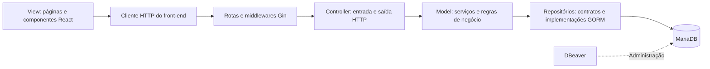

# Radar Literário

Documento de gestão e orientação do desenvolvimento do Radar Literário: uma aplicação web para organizar leituras, descobrir obras e compartilhar diários e avaliações.

**Arquitetura definida:** TypeScript, React e Tailwind CSS no front-end; Go, Gin e GORM no back-end; MariaDB como banco relacional, SQL para consultas e migrações e DBeaver para administração. O desenvolvimento seguirá o padrão **MVC**, respeitando a organização existente do repositório.

> O backend Go/MariaDB está implementado em `Backend/cmd` e `Backend/internal`, com execução e evidências em [Backend/README.md](Backend/README.md) e [Docs/cobertura_backend.md](Docs/cobertura_backend.md). O frontend atual continua sendo um protótipo separado; sua reescrita e integração permanecem trabalho futuro.

## 1. Referências e situação atual

As fontes de requisitos são a [especificação do projeto](Docs/RadarLiterárioV2.pdf) e as [referências de interface](Docs/imagens.pdf). O [README do protótipo](Frontend/radar_literario/README.md) registra o comportamento da atividade existente. Em caso de divergência, registrar a decisão antes de implementar a funcionalidade.

A divisão do Model preserva as responsabilidades de [interfaces](Backend/internal/model/interfaces/), [implementações](Backend/internal/model/tools/) e [requests/responses](Backend/internal/model/schemas/).

| Área | O que existe | Como será desenvolvido |
| --- | --- | --- |
| Front-end | React com Vite, JavaScript/JSX, Tailwind e CSS próprio; serviço com dados em memória. | Nova aplicação em TypeScript/TSX, mantendo React, Tailwind e Vite. |
| Back-end | API Go/Gin/GORM com contas, catálogo, leitura, comunidade, administração e complementos. | Manter contratos, regras e verificações junto às mudanças. |
| Organização MVC | `cmd` compõe controllers, serviços e repositórios em `internal`; View no frontend. | Integrar a View pelos contratos documentados. |
| Persistência | MariaDB, migrações SQL Goose, constraints e testes com banco isolado. | Operar backup, retenção e ambientes de implantação. |
| Ambiente | Go, MariaDB, Node.js e DBeaver; Windows não depende de Nix. | Validar Nix/Compose no ambiente que os utilizar. |

O protótipo não oferece autenticação, autorização ou persistência reais. As ações demonstradas nele não equivalem a requisitos já implementados.

## 2. Responsabilidades da stack

| Tecnologia | Responsabilidade |
| --- | --- |
| TypeScript | Tipar dados, componentes e contratos HTTP do front-end. |
| React | Construir páginas, componentes e interações da interface. |
| Tailwind CSS | Aplicar estilos, responsividade e padrões visuais reutilizáveis. |
| Vite | Executar o ambiente de desenvolvimento e gerar os arquivos estáticos do front-end. |
| Go | Implementar a API, as regras de negócio e o acesso a dados. |
| Gin | Definir rotas, middlewares, leitura de requisições e respostas HTTP. |
| GORM | Mapear entidades e executar operações de persistência no MariaDB. |
| MariaDB e SQL | Armazenar dados relacionais, garantir integridade e versionar alterações de esquema. |
| DBeaver | Inspecionar o banco, consultar dados, analisar relacionamentos e apoiar a administração. |

O back-end utilizará `gorm.io/driver/mysql` para a conexão com MariaDB. A configuração segue a [documentação do GORM](https://gorm.io/docs/connecting_to_the_database.html), e a compatibilidade com MariaDB está documentada no [driver SQL utilizado](https://github.com/go-sql-driver/mysql#requirements).

As versões Go e dependências estão registradas em `Backend/go.mod`/`go.sum`; o ambiente validado usa Go 1.27.3 e MariaDB 13.0.2. As versões do protótipo não determinam as da futura View.

## 3. Aplicação do padrão MVC

Como a interface será uma aplicação React separada da API, a View ficará no front-end. O back-end concentrará os Controllers e o Model.



As respostas percorrem o caminho de volta em JSON. Somente a API acessará o banco durante o uso da aplicação.

| Camada | Responsabilidade | Local |
| --- | --- | --- |
| View | Renderizar telas, capturar ações e apresentar carregamento, sucesso e erros. | `Frontend/radar_literario/src/` |
| Controller | Ler parâmetros e JSON, validar o formato, chamar serviços e traduzir resultados para HTTP. | `Backend/internal/controller/` |
| Model: entidades | Representar leitores, obras, edições e demais entidades e seus mapeamentos. | `Backend/internal/model/core/` |
| Model: serviços | Aplicar regras de negócio, verificar permissões sobre recursos e coordenar operações. | `Backend/internal/model/services/` |
| Model: interfaces | Declarar os contratos de repositórios necessários aos serviços. | `Backend/internal/model/interfaces/` |
| Model: implementações | Implementar os contratos de persistência com GORM e SQL. | `Backend/internal/model/tools/` |
| Schemas | Definir os objetos de transferência de dados (DTOs) de requisição e resposta, preservando a função descrita nas notas atuais. | `Backend/internal/model/schemas/` |

Os serviços receberão interfaces de repositório por injeção de dependências. O `main.go` montará a conexão, os repositórios, os serviços e os controllers. Os serviços não dependerão de `gin.Context`; o contexto da requisição será propagado como `context.Context` até as consultas.

Controllers não executarão consultas diretamente. Componentes React não conterão regras de autorização ou acesso ao banco. Validações de interface melhorarão a experiência, mas a API aplicará as validações definitivas.

## 4. Estrutura do backend e direção do frontend

A estrutura executável do backend preserva `cmd` e `internal`. A árvore TypeScript do frontend abaixo continua sendo um destino futuro; não descreve uma integração entregue nesta implementação.

```text
Radar-Literario/
├── README.md
├── Docs/
│   ├── RadarLiterárioV2.pdf
│   ├── imagens.pdf
│   ├── api.yaml                      # Contrato OpenAPI completo
│   └── decisoes.md                   # Decisões e dúvidas resolvidas
├── Backend/
│   ├── README.md                     # Instruções específicas da API
│   ├── cmd/api/main.go               # Inicialização e composição
│   ├── cmd/admin/main.go             # Bootstrap administrativo
│   ├── cmd/migrate/main.go           # Executor Goose
│   ├── cmd/setup/main.go             # Preparação local nova
│   ├── cmd/seed/main.go              # Dados fictícios opcionais
│   ├── cmd/maintenance/main.go       # Retenção
│   ├── cmd/openapi/main.go           # Contrato verificável
│   ├── go.mod
│   ├── go.sum
│   ├── .env.example
│   ├── migrations/                   # Migrações SQL numeradas
│   └── internal/
│       ├── config/                   # Configuração por ambiente
│       ├── database/                 # Conexão e pool do banco
│       ├── router/                   # Registro de endpoints
│       ├── middleware/               # Autenticação, CORS e logs
│       ├── controller/               # Handlers HTTP por recurso
│       └── model/
│           ├── core/                 # Entidades em Go
│           ├── interfaces/           # Contratos de repositório
│           ├── tools/                # Repositórios GORM
│           ├── schemas/              # Requests e responses
│           └── services/             # Casos de uso e regras
├── Frontend/
│   └── radar_literario/
│       ├── README.md
│       ├── package.json
│       ├── package-lock.json
│       ├── tsconfig.json
│       ├── vite.config.ts
│       ├── .env.example
│       ├── public/
│       └── src/
│           ├── main.tsx
│           ├── App.tsx
│           ├── pages/                # Telas e composição dos fluxos
│           ├── components/           # Elementos reutilizáveis
│           ├── hooks/                # Estado e coordenação da interface
│           ├── services/             # Cliente HTTP e chamadas à API
│           ├── types/                # Tipos e contratos TypeScript
│           ├── routes/               # Navegação da aplicação
│           ├── styles/               # Entrada do Tailwind e estilos globais
│           └── assets/
└── flake.nix
```

Testes Go ficarão próximos aos arquivos testados, com sufixo `_test.go`. Testes de interface poderão ficar próximos aos componentes e hooks. As pastas atuais `core`, `interfaces`, `tools` e `schemas` manterão suas funções, com implementação em Go no lugar de Python.

O inventário não encontrou aplicação Python remanescente. A configuração Python obsoleta do flake foi substituída por Go/MariaDB; o ambiente frontend foi preservado. O `.gitignore` protege segredos, dependências instaladas e artefatos gerados.

## 5. Como uma funcionalidade será codificada

Cada entrega deverá cobrir um fluxo completo, do requisito ao banco e à interface. Exemplo: registrar um diário de leitura.

1. Localizar o requisito na especificação e registrar regras e critérios de aceite na tarefa.
2. Definir entidades e relacionamentos envolvidos: leitor, obra, edição, item da estante e diário.
3. Atualizar o contrato HTTP em `Docs/api.yaml`, com payloads, respostas e erros.
4. Criar ou ajustar a migração SQL, as entidades em `core` e os DTOs em `schemas`.
5. Declarar a interface de repositório e implementar a persistência em `tools`.
6. Implementar o serviço: obter o leitor autenticado, validar a relação com a estante, conferir páginas e aplicar as regras da publicação.
7. Implementar controller, rota e proteção de acesso. Usar os recursos de [binding e validação do Gin](https://gin-gonic.com/en/docs/binding/binding-and-validation/) para verificar a entrada e devolver erros consistentes.
8. Implementar chamada HTTP tipada, hook e tela React, incluindo estados de carregamento, ausência de dados e falha.
9. Validar o fluxo com testes de regra de negócio, integração com MariaDB e verificação da interface.

Se uma operação atualizar o progresso e criar o diário, as gravações deverão ocorrer na mesma transação. A coordenação ficará no serviço, com suporte transacional da camada de persistência. Uma falha não poderá deixar somente parte da operação gravada.

### Convenções do back-end

- Usar arquivos Go em `snake_case`, pacotes em minúsculas e nomes exportados conforme as convenções de Go. Documentação e mensagens para o usuário serão em português; novos identificadores de código e campos da API serão em inglês.
- Organizar arquivos por recurso e responsabilidade, como `reader_controller.go`, `reading_service.go` e `reader_repository.go`, evitando concentrar todas as entidades em um único `classes.go`.
- Manter regras nos serviços e consultas nos repositórios. SQL manual ficará na camada de persistência e usará parâmetros.
- Separar entidades GORM de DTOs públicos. Responses não deverão expor hashes de senha, dados internos ou campos que o usuário não pode consultar.
- Tratar erros explicitamente e convertê-los para respostas conhecidas, sem devolver detalhes internos do banco.

### Convenções do front-end

- Usar `.tsx` para componentes e `.ts` para serviços, tipos e utilitários; habilitar [`strict` no TypeScript](https://www.typescriptlang.org/tsconfig/strict) e evitar `any` sem justificativa.
- Dividir telas em páginas e componentes pequenos, com componentes React em `PascalCase`. O novo `App.tsx` ficará responsável pela composição principal.
- Centralizar URL da API, serialização e tratamento de falhas no cliente HTTP. Nenhuma página fará acesso direto ao banco.
- Manter os tipos de requests e responses alinhados ao OpenAPI. Tipos TypeScript não substituem validação de dados em execução no servidor.
- Usar Tailwind como base visual, com padrões compartilhados para cores, espaçamentos, formulários e componentes; reservar CSS próprio para necessidades específicas.
- Implementar navegação, formulários acessíveis, foco, responsividade e mensagens de validação desde cada entrega.

O novo front-end será desenvolvido a partir dos requisitos e referências visuais. O serviço atual `libraryService.js` ajuda a identificar ações do protótipo, mas não define o contrato definitivo da API.

## 6. Domínio, dados e regras

A especificação prevê leitores e administradores, catálogo, estante pessoal, diários, avaliações, interações sociais, estatísticas, recomendações, denúncias, sugestões de alteração de obras e suporte. A modelagem será validada antes das migrações.

| Grupo | Entidades candidatas e relações |
| --- | --- |
| Contas | Identidade base `users`, perfis leitor/administrador por composição, sessões e recuperação persistidas. |
| Catálogo | Obra, edição, autores N:M conforme PNG, editoras e gêneros N:M; ISBN, páginas, idioma, editora e publicação pertencem à edição. |
| Estante | Relação entre leitor e obra, com status; propõe-se referenciar também a edição usada na leitura para calcular o progresso. |
| Publicações | Diários e avaliações vinculados ao leitor autor e à obra, com referência à edição quando necessária e indicadores de spoiler e conteúdo sensível. |
| Interações | Comentários e curtidas associados ao leitor responsável e ao conteúdo de destino; o modelo conceitual também prevê curtidas em comentários. |
| Administração | Denúncias, sugestões de alterações do catálogo, decisões de moderação e registros de punições. |
| Suporte | FAQ e solicitações de suporte, conforme detalhamento da especificação. |

**Obra e edição serão conceitos distintos.** Os registros simplificados de `mockData.js`, que juntam catálogo, progresso pessoal e nota, não serão copiados como modelo relacional definitivo.

Regras a preservar na implementação:

- Cada leitor terá um único status por obra na estante: quero ler, lendo, lido ou abandonado (RN04), mais pausado conforme o diagrama.
- O diário exigirá conteúdo e progresso; ao registrá-lo, uma obra com status diferente de lendo ou lido passará automaticamente para lendo (UC02/E01).
- Diário e avaliação terão autoria identificada; edição e exclusão pelo leitor ficarão restritas ao próprio conteúdo (RN03 e casos de uso).
- Toda publicação deverá declarar a presença ou ausência de spoiler (RN02). Diários e avaliações permitirão marcar conteúdo sensível; spoilers e conteúdo sensível ficarão ocultos até confirmação do leitor (RF23 e RF24).
- Avaliações utilizarão a escala de 1 a 5 (RN01). Ao criar, alterar ou excluir uma avaliação, a média da obra será atualizada de forma consistente (UC03). Os critérios para permitir a publicação precisam da decisão registrada abaixo.
- Estatísticas pessoais serão calculadas a partir dos registros do próprio leitor (RN05).
- Permissões administrativas serão verificadas na API, incluindo a restrição de um administrador banir outro administrador (RN07).
- Denúncias serão registradas e seguirão um fluxo de moderação. Inclusões, alterações e exclusões de catálogo sugeridas por leitores passarão por triagem administrativa (RF33 e UC08). Remover da estante será uma operação diferente de excluir uma obra do catálogo.
- O acesso a diários e avaliações respeitará a faixa etária do leitor, após definir os critérios que a regra NR08 deixa em aberto.

Como validação técnica proposta, o progresso deverá ficar entre zero e o total de páginas da edição. Essa associação será confirmada na modelagem, pois o documento não detalha todos os limites de progresso.

O banco utilizará chaves primárias, chaves estrangeiras, campos obrigatórios e índices conforme as consultas. Identificadores únicos de conta terão restrições de unicidade; a estante terá unicidade por leitor e obra; curtidas terão unicidade por leitor e conteúdo de destino. Progresso pessoal e nota individual não serão atributos globais da obra.

As migrações SQL em `Backend/migrations/` serão a referência do esquema e deverão ser aplicadas em ordem, por uma ferramenta de migração escolhida na preparação. Uma migração já aplicada em ambiente compartilhado será corrigida por uma nova migração. `AutoMigrate` poderá ser usado em experimentos descartáveis, sem substituir esse histórico.

O DBeaver será configurado para a mesma instância MariaDB utilizada pela API, com credenciais apropriadas ao ambiente. Alterações de esquema feitas para experimentação deverão ser convertidas em migrações revisadas antes de integrar o projeto. A aplicação usará um usuário de banco com permissões limitadas às operações necessárias; a aplicação de migrações terá credenciais próprias.

## 7. Contrato da API e integração

A API usa JSON e prefixo `/api/v1`. A tabela abaixo resume recursos; o [OpenAPI completo](Docs/api.yaml) é o contrato executável e inclui caminhos concretos, DTOs, paginação, CSRF e permissões.

| Recurso | Rotas propostas | Finalidade |
| --- | --- | --- |
| Contas e sessão | `POST /api/v1/readers`, `POST /api/v1/auth/login`, `POST /api/v1/auth/logout` | Cadastro e controle de acesso. |
| Perfil | `GET`, `PATCH`, `DELETE /api/v1/me` | Consulta e manutenção da própria conta. |
| Catálogo | `GET /api/v1/works`, `GET /api/v1/works/:id`, `GET /api/v1/works/:id/editions` | Pesquisa de obras e consulta de edições. |
| Estante | `GET /api/v1/me/shelf`, `PUT`, `DELETE /api/v1/me/shelf/:work_id` | Gerenciar a relação pessoal com cada obra. |
| Diários | `POST /api/v1/reading-entries`, `PATCH`, `DELETE /api/v1/reading-entries/:id` | Registrar e manter diários próprios. |
| Avaliações | `POST /api/v1/reviews`, `PATCH`, `DELETE /api/v1/reviews/:id` | Publicar e manter avaliações próprias. |
| Publicações | `GET /api/v1/posts`, `GET`, `POST /api/v1/posts/:id/comments` | Feed e comentários vinculados à publicação. |
| Curtidas | `PUT`, `DELETE /api/v1/posts/:id/like` | Curtir e descurtir de forma idempotente. |
| Denúncias | `POST /api/v1/reports` | Encaminhar conteúdo para análise. |

Rotas administrativas, manutenção do catálogo, recomendações, estatísticas e suporte constam no OpenAPI. Operações privadas exigem autenticação e autorização sobre o recurso; conhecer um ID não dá permissão para alterá-lo.

Os campos JSON utilizarão `snake_case`, com datas e horários em ISO 8601 e persistência em UTC. Listagens terão paginação e limites definidos no contrato. A identidade do autor virá da sessão validada pela API, sem confiar em um `reader_id` enviado pela interface.

Respostas utilizarão códigos HTTP coerentes: `200` para consultas e atualizações com corpo, `201` para criação, `204` para sucesso sem corpo, `400` para entrada inválida, `401` para ausência de autenticação, `403` para acesso negado, `404` para recurso não encontrado, `409` para conflitos e `500` para falhas internas.

Exemplo do formato de erro implementado:

```json
{
  "error": {
    "code": "INVALID_READING_PROGRESS",
    "message": "O progresso não pode ultrapassar o total de páginas da edição.",
    "fields": {
      "current_page": "Informe uma página válida para esta edição."
    }
  }
}
```

## 8. Configuração, acesso e execução

### Executar o protótipo atual

Com Node.js e npm compatíveis com o `package.json` existente, a partir da raiz:

```sh
cd Frontend/radar_literario
npm install
npm run dev
```

Nesse mesmo diretório, `npm run lint` verifica o código atual e `npm run build` gera os arquivos de produção. Não é necessário iniciar uma API para visualizar o protótipo.

### Preparar o ambiente definitivo

Go e MariaDB foram configurados para o backend e o `flake.nix` foi alinhado à stack, preservando o frontend. As versões e o procedimento completo estão no README de cada aplicação.

Resumo das variáveis de banco de `Backend/.env.example` (veja o arquivo para a configuração completa, inclusive a chave da outbox):

```dotenv
APP_ENV=development
HTTP_PORT=8080
DB_HOST=127.0.0.1
DB_PORT=3306
DB_NAME=radar_literario
DB_USER=radar_app
DB_PASSWORD=defina_localmente
CORS_ALLOWED_ORIGINS=http://localhost:5173
```

Exemplo para `Frontend/radar_literario/.env.example`:

```dotenv
VITE_API_BASE_URL=http://localhost:8080/api/v1
```

O pacote `config` carrega `.env` explicitamente; Go não o faz automaticamente. A conexão GORM usa essas variáveis, `utf8mb4`, datas UTC e limites do pool. `.env.example` contém somente exemplos; segredos reais ficam fora do Git. Variáveis `VITE_*` são públicas no navegador e não podem receber segredos.

Para executar o backend: iniciar MariaDB, aplicar migrações e iniciar a API a partir de `Backend`. O frontend atual pode ser executado independentemente em outro terminal. Os comandos da API são:

```sh
cd Backend
go mod download
go run ./cmd/api
```

Antes de executar, configure o banco e aplique as migrações com `go run ./cmd/migrate -command up` usando `.env.migrate`, conforme [README da API](Backend/README.md). Existe módulo Go e a aplicação é iniciada por `cmd/api`.

A autenticação usa sessão opaca persistida no servidor, cookie `HttpOnly`, `Secure` em produção e `SameSite` configurável. Há expiração absoluta/por inatividade, rotação, revogação e CSRF nas escritas, inclusive pré-login. O CORS permite apenas origens configuradas; a futura View enviará credenciais.

Senhas usam bcrypt custo 12; sessões e tokens usam segredos aleatórios armazenados como hash. Logs não registram corpos nem credenciais. Recuperação tem consumo único e outbox SMTP cifrada. Veja os detalhes e exemplos no README do backend.

## 9. Plano de entregas e gestão

As etapas representam dependências e resultados esperados, sem pressupor prazos ou pessoas ainda não definidos. Cada tarefa terá um responsável e um revisor; esses papéis poderão ser exercidos pela mesma pessoa quando o desenvolvimento for individual.

| Etapa | Trabalho previsto | Critério de conclusão |
| --- | --- | --- |
| 1. Preparação | Revisar requisitos, resolver ambiguidades, escolher versões e ferramenta de migração, atualizar ambiente e criar esqueleto Go/TypeScript. | Projetos inicializam; estrutura MVC, configuração, banco de desenvolvimento e contrato inicial estão definidos. |
| 2. Contas e acesso | Implementar leitor, perfil, sessão, validações e permissões. | Cadastro, login, logout e acesso ao próprio perfil funcionam com persistência e proteção de rotas. |
| 3. Catálogo e estante | Modelar obras, edições e relações; implementar pesquisa e estante pessoal. | Obra e edição estão separadas; cada leitor gerencia seus status sem alterar a estante de outro leitor. |
| 4. Leitura e avaliações | Implementar diários, progresso, notas e indicação de spoiler. | Registros persistem, respeitam autoria e regras definidas e alimentam corretamente o histórico pessoal. |
| 5. Comunidade | Implementar feed, comentários e curtidas. | Interações estão vinculadas à publicação e ao leitor, com paginação e controle de acesso. |
| 6. Administração e recursos complementares | Implementar denúncias, sugestões de alterações, moderação, estatísticas, recomendações e suporte em tarefas separadas. | Fluxos seguem os requisitos e permissões, com critérios específicos registrados em cada tarefa. |
| 7. Consolidação | Revisar testes, acessibilidade, configuração de produção, backup e documentação. | Instalação reproduzível, migrações verificadas e fluxos principais validados na aplicação integrada. |

A reescrita do front-end acompanhará as entregas funcionais a partir da etapa 1. Cada fluxo substituirá a simulação por integração com a API; o protótipo não será tratado como uma implementação que precisa ser mantida na versão final.

### Fluxo de trabalho

1. Criar tarefa com requisito de origem, escopo, critérios de aceite, dependências e responsável.
2. Mover a tarefa por: a fazer, em andamento, em revisão e concluída.
3. Trabalhar em uma branch por tarefa, com commits pequenos e descritivos.
4. Revisar código, migrações, contratos e testes antes de integrar a entrega.
5. Atualizar os documentos afetados e registrar decisões em `Docs/decisoes.md`.

Mudanças de contrato deverão atualizar API e front-end na mesma entrega ou prever compatibilidade explícita. Mudanças de escopo terão o impacto e a prioridade registrados na tarefa.

### Critérios para considerar uma entrega concluída

- Requisito atendido e critérios de aceite verificados com dados persistidos quando aplicável.
- Responsabilidades MVC preservadas e permissões verificadas no servidor.
- Contrato, migrações, configuração e documentação atualizados conforme a alteração.
- Testes relevantes aprovados: serviços para regras; API e repositórios contra MariaDB para persistência, integridade e transações; interface para os fluxos alterados.
- Go formatado e validado com `go vet ./...` e `go test ./...` a partir de `Backend`, após sua implementação.
- Front-end aprovado em lint, verificação de tipos e build; adicionar scripts `typecheck` e `test` na reescrita, pois eles não existem no protótipo atual.

Os testes de integração usarão um banco separado, nunca dados pessoais ou de produção. A verificação incluirá cenários de falha e tentativa de acesso a recursos de outro leitor, além dos caminhos de sucesso.

## 10. Decisões do backend

| Questão | Encaminhamento |
| --- | --- |
| Quando uma avaliação pode ser publicada? | Leitura em andamento ou concluída, compatibilizando UC03. |
| Qual é o escopo de uma avaliação existente? | Uma vigente por leitor/obra; exclusão voluntária libera novo post, moderação preserva bloqueio; média SQL das elegíveis. |
| Como aplicar a restrição etária? | Classificação 0/10/12/14/16/18; idade civil autodeclarada; visitante sem idade só classificação 0; obra atual limita todos os caminhos. |
| Como tratar exclusões de conta e conteúdo? | Anonimização/remoção privada imediata, conteúdo indisponível e purga configurável das evidências restritas. |
| Como cadastrar e alterar obras e edições? | CRUD administrativo; leitores usam sugestões com versão do alvo e decisão transacional auditada; ISBN canônico na edição. |
| Como calcular recomendações e estatísticas? | SQL determinístico de afinidade/gêneros, médias/amostras e eventos de progresso UTC; fórmulas nos documentos de cobertura. |
| Como executar e publicar a aplicação? | Go 1.27.3, MariaDB, Goose e instruções Windows/Linux no README; backup restaurado em ensaio; hospedagem/HTTPS e agendamento permanecem operacionais futuros. |

As questões acima foram resolvidas para o backend pelo prompt e estão registradas com contexto, escolha, impacto e aceite em [decisoes.md](Docs/decisoes.md), seus complementos por módulo e [cobertura_backend.md](Docs/cobertura_backend.md). Avaliação é única por leitor/obra enquanto vigente e permitida em leitura/conclusão; idade usa classificação 0/10/12/14/16/18; exclusão anonimiza identidade e restringe evidências; estatísticas/recomendações têm fórmulas SQL determinísticas. Publicação/hospedagem e integração da View permanecem fora desta implementação.
